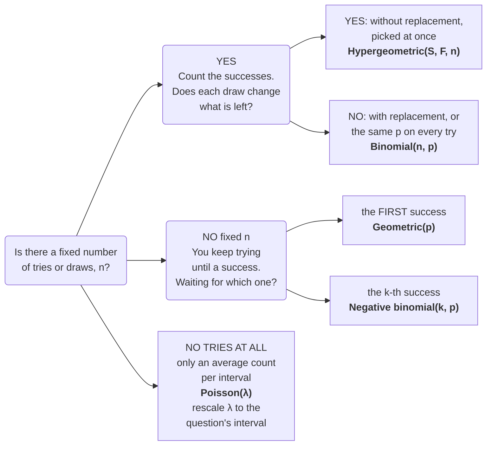
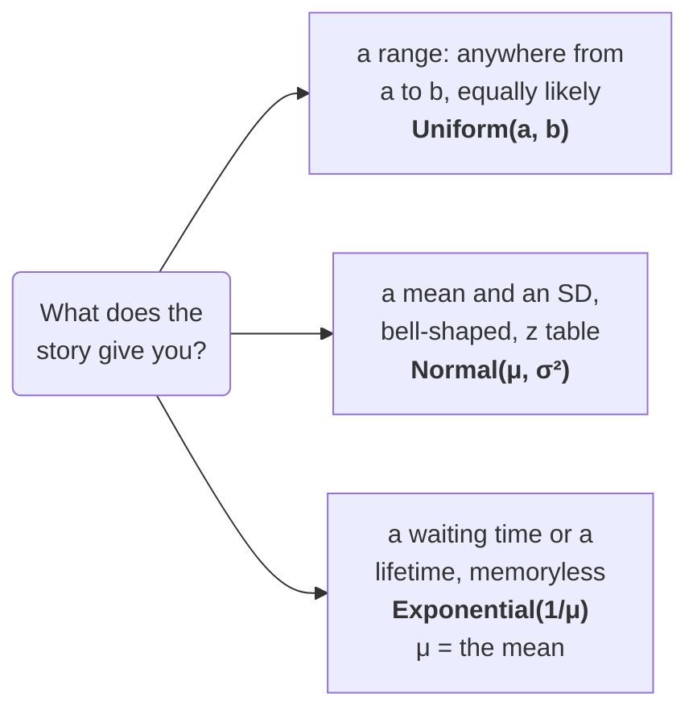

## How to use this page

1. Cover the answer. Read the story once.
2. Say the opening line in your head: `X ~ Name(parameters)` plus what is asked, for example `P(X ≤ 2)`.
3. Reveal. If your first line was wrong, mark the question and move on, do not fix the working.
4. Screen at work, pen at night: the same questions again on paper, first line, then formula, then the number.

## The decision tree

First question, every time: am I **counting** or **measuring**?

**Counting** (how many, or which try) is discrete. Read left to right:

**Measuring** (how long, how heavy, how tall) is continuous:

The letters: $S$ successes and $F$ failures in the pool, $n$ drawn; $k$ successes waited for; $p$ is the chance of one success and $q = 1 - p$. The bracket of the exponential holds the RATE $\lambda = 1/\mu$, so a mean of 5 minutes is Exponential$(1/5)$. Geometric and negative binomial both count TRIALS, so $X$ includes the trial of the last success.

## Words that name it

Two questions name the four stories with tries: is the chance the same on every try, and what is fixed, the number of tries or the number of successes? $X$ counts the other one. A story with no tries, only an average rate ("30 an hour"), is named by what $X$ is: a count of arrivals, or a time.

| The story says | $X$ is | Answer | Name |
|---|---|---|---|
| "at once", "take 3 from a drawer of 9", "without replacement" | how many of one kind in your hand | Not put back, so the chance changes | Hypergeometric$(S, F, n)$ |
| "until the first ..." | which try | Same chance; the 1st success is fixed | Geometric$(p)$ |
| "until the 3rd ..." | which try | Same chance; the 3rd success is fixed | Negative binomial$(k, p)$ with $k = 3$ |
| a set number of tries ("10 questions", "8 phones tested"), $X$ = how many | how many successes | Same chance; the tries are fixed | Binomial$(n, p)$ |
| "30 an hour on average", "how many in the next 5 minutes" | how many arrivals in a window | No tries; $\lambda$ = rate × window | Poisson$(\lambda)$ |
| "how long until the next", "lifetime", "an average wait of 2 minutes" | a time | No tries; $\mu$ = the average wait = 1 / rate | Exponential$(1/\mu)$ |

Same website at 30 visits an hour, two questions: visits in the next 5 minutes is Poisson$(2.5)$, minutes until the next visit is Exponential$(1/2)$. Not every time is exponential: a time equally likely anywhere in a range is uniform, and one given with a mean and an SD is normal (section 9).

$n$ is always how many you take or try, never the pool: 3 socks taken from a drawer of 9 is $n = 3$, and the 9 is $S + F$.

### Three checks for the numbers

The name is the easy half. The slips that cost marks are usually a right number in the wrong slot, and each of these takes ten seconds:

1. **$p$ belongs to what $X$ counts or waits for.** Read it from the question's last words. "The shot of the first miss" makes a miss the success, so a shooter who hits 70% of the time gives $p = 0.3$.
2. **Big numbers add to the pool, small numbers add to the hand.** In $\binom{S}{x}\binom{F}{n-x}$ the big numbers give $S + F = N$ and the small ones give $x + (n - x) = n$. The bottom is always $\binom{N}{n}$.
3. **Read each C aloud as "this many of that kind".** $\binom{6}{3}$ is "3 of the 6 women". The $x$ from $P(X = x)$ goes with the kind $X$ counts, and so does $S$.

## Reading the symbols

One example all the way through: 5 picks from a box of 20 chips, 6 of them faulty, each chip put back before the next pick. $X$ is the number of faulty chips you get, so it can be 0, 1, 2, 3, 4 or 5. This is the chance of each, the whole of $\text{Binomial}(5, 0.3)$:

| $x$ | 0 | 1 | 2 | 3 | 4 | 5 |
|---|---|---|---|---|---|---|
| $P(X = x)$ | 0.1681 | 0.3602 | **0.3087** | 0.1323 | 0.0284 | 0.0024 |

The six chances add up to 1, and $P(X = 2) = 0.3087$ is one cell.

| Write | Means | In code terms |
|---|---|---|
| $X$ | the count you don't know yet: faulty chips in the 5 picks | a variable |
| $X \sim \text{Binomial}(5, 0.3)$ | $X$ follows the binomial with $n = 5$ and $p = 0.3$, the whole table above | a type: `X: Binomial(5, 0.3)` |
| $f(x)$ | the rule that fills in each cell: $\binom{5}{x}(0.3)^x(0.7)^{5-x}$ | a function |
| $P(X = 2)$ | one cell: $f(2) = \binom{5}{2}(0.3)^2(0.7)^3 = 0.3087$ | calling the function with 2 |

Read $\sim$ as "follows": it says what kind of thing $X$ is, while $=$ gives a number. So $f(2) = \text{Binomial}(5, 0.3)$ is wrong, the same way a type never equals a value.

**Their sheet, translated.** $f(x)$ is $P(X = x)$. The tall bracket $\binom{n}{x}$ is nCx on the calculator (the nCr key). $q$ is $1 - p$. A question that asks for "the probability distribution of $X$" or "the pmf" wants the whole table or the $f(x)$ formula, not one number.

**On paper, every time:** say what $X$ counts, write the $\sim$ line, write $P(X = \dots)$ for what is asked, copy $f(x)$ from their sheet, put the numbers in, and finish with the number to 4 decimal places.

## One box, four questions

A box holds 20 chips, 6 of them faulty. Change how you pick, and the distribution changes:

| # | How you pick | $X$ counts | Name line |
|---|---|---|---|
| 1 | grab 5 at once | how many are faulty | $X \sim \text{Hypergeometric}(S = 6, F = 14, n = 5)$ |
| 2 | 5 picks, each chip put back | how many are faulty | $X \sim \text{Binomial}(5, 0.3)$ |
| 3 | put back, stop at the first faulty chip | which pick | $X \sim \text{Geometric}(0.3)$ |
| 4 | put back, stop at the 3rd faulty chip | which pick | $X \sim \text{Negative binomial}(3, 0.3)$ |

### Box 1: grab 5 at once (hypergeometric)

**The picture.** The technician grabs a handful of 5, and every handful is equally likely. So count handfuls:

- all handfuls: $\binom{20}{5} = 15504$
- handfuls with exactly 2 faulty: choose 2 of the 6 faulty and 3 of the 14 good, $\binom{6}{2}\binom{14}{3} = 15 \times 364 = 5460$
- so $P(X = 2) = \dfrac{5460}{15504} = 0.3522$

That fraction is the whole formula, $f(x) = \dfrac{\binom{S}{x}\binom{F}{n-x}}{\binom{S+F}{n}}$: the ways to pick the ones you count, times the ways to pick the rest, over all handfuls.

**Setting $S$, $F$ and $n$: three questions.** What am I counting? How many of those are in the box is $S$. Everything else in the box is $F$. How many do I take is $n$. Check that $S + F$ is the whole box. "Success" means whatever the question counts, even when it is bad: here $S$ is the 6 faulty chips.

**Where it is.** Not on their sheet, so it goes on yours (§6). The calculator has no hypergeometric button, so work it with the nCr key.

**Practice.**

1. A jar holds 10 sweets, 4 of them sour. You grab 3 at once. Find the probability that exactly 1 is sour.

Answer

$X \sim \text{Hypergeometric}(S = 4, F = 6, n = 3)$, where $X$ is the number of sour sweets, and $P(X = 1)$ is asked.

$P(X = 1) = \dfrac{\binom{4}{1}\binom{6}{2}}{\binom{10}{3}} = \dfrac{4 \times 15}{120} = 0.5$

2. A club has 8 women and 7 men. A committee of 4 is chosen at random, and $X$ is the number of men on it. Find $S$, $F$ and $n$, then $P(X = 2)$.

Answer

$X \sim \text{Hypergeometric}(S = 7, F = 8, n = 4)$. The question counts men, so the 7 men are $S$, even though the story names the women first.

$P(X = 2) = \dfrac{\binom{7}{2}\binom{8}{2}}{\binom{15}{4}} = \dfrac{21 \times 28}{1365} = 0.4308$

### Box 2: put each chip back (binomial)

**The picture.** Pick one chip, look at it, put it back and shake the box, then do that 5 times. Every pick sees 20 chips with 6 faulty, so every pick is faulty with the same chance, $p = 6/20 = 0.3$. A chip can now come up twice, so handfuls no longer describe what happened: count picks instead.

**Built from orders.** Exactly 2 faulty (F) and 3 good (G). One order, F F G G G, has chance $0.3 \times 0.3 \times 0.7 \times 0.7 \times 0.7 = 0.03087$, and every order with two F's has that same chance. There are $\binom{5}{2} = 10$ such orders, one for each choice of which 2 picks are the faulty ones:

`FFGGG` `FGFGG` `FGGFG` `FGGGF` `GFFGG` `GFGFG` `GFGGF` `GGFFG` `GGFGF` `GGGFF`

So $P(X = 2) = \binom{5}{2}(0.3)^2(0.7)^3 = 10 \times 0.03087 = 0.3087$, and that is the binomial: $f(x) = \binom{n}{x}p^x q^{n-x}$.

**In one sentence:** a fixed number of tries, the same chance every time, count the hits. The box itself no longer matters, so a box of 200 chips with 60 faulty gives the same $\text{Binomial}(5, 0.3)$. Only $n$ (how many tries) and $p$ (the chance per try) do.

**Where it is.** Their sheet, page 1, "X ~ Binomial (n, p)", with $E(X) = np$ and $V(X) = npq$. On the calculator: Binomial PD, with $x$, $N = n$ and $p$.

| | Nothing goes back | Each chip goes back |
|---|---|---|
| Name | $\text{Hypergeometric}(6, 14, 5)$ | $\text{Binomial}(5, 0.3)$ |
| Chance per pick | changes: 6/20, then 5/19 or 6/19 | always 6/20 |
| The C chooses | which chips | which picks were faulty |
| $P(X = 2)$ | 0.3522 | 0.3087 |
| On their sheet | no, your §6 | yes, page 1 |

**When the question is not "exactly".** Ask "is the number itself included?" before you write:

| Asked | Write | For $\text{Binomial}(5, 0.3)$ |
|---|---|---|
| exactly 2 | $P(X = 2)$ | 0.3087 |
| at most 2 | $P(X = 0) + P(X = 1) + P(X = 2)$ | 0.8369 |
| at least 2 | $1 - P(X = 0) - P(X = 1)$ | 0.4718 |
| more than 2 | $1 - P(X \le 2)$ | 0.1631 |

**Practice.**

1. 10% of phones fail a quality test, independently. An inspector tests 8 phones. Find the probability that exactly 1 fails.

Answer

$X \sim \text{Binomial}(8, 0.1)$, where $X$ is the number of phones that fail out of the 8 tested, and $P(X = 1)$ is asked.

$P(X = 1) = \binom{8}{1}(0.1)^1(0.9)^7 = 0.3826$

2. 15% of a shop's customers use a voucher, independently. Find the probability that exactly 2 of the next 12 customers use one.

Answer

$X \sim \text{Binomial}(12, 0.15)$, where $X$ is the number of the 12 customers who use a voucher, and $P(X = 2)$ is asked.

$P(X = 2) = \binom{12}{2}(0.15)^2(0.85)^{10} = 66 \times 0.0225 \times 0.1969 = 0.2924$

3. A basketball player makes 70% of free throws, independently. Find the probability of exactly 2 misses in 6 throws.

Answer

$X \sim \text{Binomial}(6, 0.3)$, where $X$ is the number of misses, so $p$ is the miss chance, 0.3. $P(X = 2)$ is asked.

$P(X = 2) = \binom{6}{2}(0.3)^2(0.7)^4 = 15 \times 0.09 \times 0.2401 = 0.3241$

**Traps from practice.** A percentage is always $p$, never $n$: "10% of phones, 8 tested" is $n = 8$ and $p = 0.1$, not $n = 10$. And $p$ belongs to whatever $X$ counts: count misses and $p$ is the miss chance. Writing "Let $X$ = ..." first catches both.

### Box 3: stop at the first faulty chip (geometric)

**The picture.** A claw machine that wins 30% of the time, and you play until you win. Or the box: pick, put back, and stop at the first faulty chip. Nothing gets used up, so every pick has the same chances, and there is no top limit on how many picks it can take.

**What $X$ means changes.**

| | $X$ means | $X = 3$ means |
|---|---|---|
| Binomial, 5 picks | how many are faulty | 3 of the 5 picks were faulty |
| Geometric | which pick gives the first faulty one | picks 1 and 2 good, pick 3 faulty |

**Built from one order.** "And then" multiplies, by Chapter 1's multiplication rule:

| $x$ | Order | $P(X = x)$ |
|---|---|---|
| 1 | F | $0.3$ |
| 2 | G F | $0.7 \times 0.3 = 0.21$ |
| 3 | G G F | $0.7^2 \times 0.3 = 0.147$ |
| 4 | G G G F | $0.7^3 \times 0.3 = 0.1029$ |
| $x$ | $x - 1$ G's, then F | $q^{x-1}p$ |

The last factor is always $p$: $x - 1$ failures, then the one success. Only one order ends with the first faulty chip on pick $x$, so there is no C here. The binomial's $\binom{5}{2}$ was adding up its 10 equal orders.

**Which number goes where.** $p$ and $q$ come from the story (the chance on each try), and $x$ comes from the question (which try). The story's $p$ goes in the bracket, the question's $x$ goes in $P(X = x)$: $X \sim \text{Geometric}(0.3)$, then $P(X = 3) = f(3) = (0.7)^2(0.3) = 0.147$.

**Where it is.** Not on their sheet under its own name. Take their Negative Binomial box with $k = 1$: $\binom{x-1}{0}p^1q^{x-1} = pq^{x-1}$, the same formula. Or write $q^{x-1}p$ on your sheet.

**Practice.** Say the order in words before the numbers.

1. A slow website loads with probability 0.4 on each try, independently. Find the probability that it first loads on try 4.

Answer

$X \sim \text{Geometric}(0.4)$, where $X$ is the try on which it first loads, and $P(X = 4)$ is asked. Order: fail, fail, fail, LOAD.

$P(X = 4) = (0.6)^3(0.4) = 0.0864$

2. 85% of chips pass inspection, independently. An inspector checks chips one by one. Find the probability that the first chip to fail is the 3rd one checked.

Answer

$X \sim \text{Geometric}(0.15)$, where $X$ is the chip on which the first fail shows up, so $p$ is the fail chance, 0.15. $P(X = 3)$ is asked. Order: pass, pass, FAIL.

$P(X = 3) = (0.85)^2(0.15) = 0.1084$

3. A player scores 75% of free throws, independently. (a) Find the probability that the first score is on throw 2. (b) Find the probability that the first miss is on throw 4.

Answer

(a) $X \sim \text{Geometric}(0.75)$, where $X$ is the throw of the first score. Order: miss, SCORE. $P(X = 2) = (0.25)(0.75) = 0.1875$

(b) $Y \sim \text{Geometric}(0.25)$, where $Y$ is the throw of the first miss. Order: score, score, score, MISS. $P(Y = 4) = (0.75)^3(0.25) = 0.1055$

Same player and the same 75%: only the question's last word decided $p$.

**Traps from practice.** $p$ is the chance of the event the question waits for, and that is often the "bad" one: a fail, a miss, a defect. Read it from the question's last words, not from the story's first number, then say the order in words and check that the last one is that event. A geometric story needs tries that carry on whatever happens, so if a result would end the story early (a phone that unlocks), it is not geometric. And keep the two lines apart: $X \sim \text{Geometric}(0.4)$ on one, $P(X = 4)$ on the next.

### Box 4: stop at the 3rd faulty chip (negative binomial)

**The picture.** The same as box 3, but you wait for the 3rd faulty chip, so $k = 3$. $X = 5$ means pick 5 is the 3rd faulty chip: pick 5 must be F, and the other 2 F's sit anywhere in picks 1 to 4.

`FFGG F` `FGFG F` `FGGF F` `GFFG F` `GFGF F` `GGFF F`

That is $\binom{4}{2} = 6$ orders, and each has chance $0.3^3 \times 0.7^2$.

**The idea.** The geometric's ending (the last pick must be a success) plus the binomial's C (where the earlier successes sit). With $k = 1$ there is nothing to place, so it turns into the geometric.

**Where it is.** Their sheet, page 1, "X ~ Negative Binomial (k, p)": $f(x) = \binom{x-1}{k-1}p^kq^{x-k}$ for $x = k, k+1, \dots$

**Your turn.** What are $k$, $x$ and $p$ here? Plug them in.

Answer

$X \sim \text{Negative binomial}(k = 3, p = 0.3)$, where $X$ is the pick on which the 3rd faulty chip shows up, and $P(X = 5)$ is asked.

$P(X = 5) = \binom{4}{2}(0.3)^3(0.7)^2 = 6 \times 0.027 \times 0.49 = 0.0794$

## Same shop, different question

One bubble tea shop. On average 6 customers arrive every 30 minutes, so 0.2 per minute, so the mean wait for the next one is 5 minutes. Seven questions, seven distributions.

| # | The question | Count or measure | Opening line |
|---|---|---|---|
| 1 | How many customers arrive in the next 30 minutes? | count | $X \sim \text{Poisson}(6)$ |
| 2 | How many minutes until the next customer arrives? | measure | $X \sim \text{Exponential}(1/5)$, mean 5 |
| 3 | Of the next 10 customers, how many order boba, if each does with probability 0.3? | count, fixed $n$ | $X \sim \text{Binomial}(10, 0.3)$ |
| 4 | Which customer is the first to order boba (same 0.3)? | count the tries | $X \sim \text{Geometric}(0.3)$ |
| 5 | 12 staff, 4 of them new. 3 are picked for a shift. How many are new? | count, no replacement | $X \sim \text{Hypergeometric}(S=4, F=8, n=3)$ |
| 6 | How many ml are in one cup, mean 500 and SD 10? | measure | $X \sim \text{Normal}(500, 10^2)$ |
| 7 | A delivery arrives at a random time between 2 pm and 3 pm. Minutes after 2 pm? | measure | $X \sim \text{Uniform}(0, 60)$ |

Poisson and exponential describe the same customers: one counts them in a fixed window, the other measures the wait between them.

## 5. Story to distribution

**Tell.** Read the question for the word that tells you what is fixed and what is being counted. The table below is the whole skill.

| Distribution | Phrases that give it away | The parameter trap |
|---|---|---|
| Binomial$(n, p)$ | "$n$ tries", "each ... independently with probability $p$", "with replacement", "put back" | $n$ is the number of tries, $p$ is the chance of ONE try. $x$ is the count of successes, $0$ to $n$. |
| Hypergeometric$(S, F, n)$ | "picked at once", "without replacement", "kept", a team, hand or batch from a small pool with a known split | No $p$. $S$ and $F$ are counts in the pool, $n$ is how many are drawn. The with-replacement twin of the same story is Binomial$(n, S/N)$. |
| Geometric$(p)$ | "which try is the first ...", "how many attempts until the first" | $x$ is the try number, starting at 1. Success means whatever you wait for: "first miss" means $p = P(\text{miss})$. |
| Negative binomial$(k, p)$ | "which try is the 3rd ...", "how many games to win 4" | $x$ is the number of TRIALS, so it starts at $k$. Same success rule as geometric. |
| Poisson$(\lambda)$ | "on average 4 per hour", "how many in the next 20 minutes" | $\lambda$ is the mean COUNT in the interval the question asks about: rescale it first. $x$ is a count, never the minutes. |
| Uniform$(a, b)$ | "equally likely anywhere between $a$ and $b$", "a random time between" | Probability is a width: (width wanted) / ($b - a$). Measure from the start of the range. |
| Exponential$(1/\mu)$ | "how long until", "lifetime", "mean of 5 minutes", "already lasted" | Put $x$ in the unit of the mean. The bracket is the rate, the mean is $\mu$. "Already lasted" is memoryless. |
| Normal$(\mu, \sigma^2)$ | "mean ... and SD ..." of something measured, bell-shaped | The second slot is the VARIANCE: SD 12 means $\sigma^2 = 144$. (Page 2 does the z step.) |

**Where it is.** Their sheet, page 1, "Common Probability Distributions": Binomial, Poisson and Negative Binomial give the pmf, mean and variance. Geometric is not on it: take the Negative Binomial row with $k = 1$, which gives $f(x) = q^{x-1}p$, $E(X) = 1/p$. Hypergeometric is not on it either (section 6).

**Worked example.** A bike repair stand gets on average 3 flat-tyre jobs per hour. (a) Find the probability of no job in the next 20 minutes. (b) Find the probability of at least 2 jobs in the next 30 minutes.

(a) Let $X$ be the number of jobs in the next 20 minutes. The rate is 3 per hour and 20 minutes is $\frac{1}{3}$ hour, so $\lambda = 3 \times \frac{1}{3} = 1$.

$X \sim \text{Poisson}(\lambda = 1)$, with $f(x) = \dfrac{e^{-\lambda}\lambda^x}{x!}$.

$P(X = 0) = \dfrac{e^{-1} \times 1^0}{0!} = e^{-1} = 0.3679$

There is about a 37% chance of no job in the next 20 minutes. Note $x = 0$, the count. Never $x = 20$.

(b) A new interval is a new variable. Let $Y$ be the number of jobs in 30 minutes, $\lambda = 3 \times \frac{1}{2} = 1.5$, so $Y \sim \text{Poisson}(1.5)$.

$P(Y \ge 2) = 1 - P(Y = 0) - P(Y = 1) = 1 - e^{-1.5} - 1.5e^{-1.5} = 1 - 0.2231 - 0.3347 = 0.4422$

There is about a 44% chance of two or more jobs in the next half hour.

**Twins.** Say the opening line first.

1. A basketball trainee makes 70% of her free throws, each throw independent. Which throw is her first miss? Find the probability that her first miss is the 4th throw, and the probability that she makes the first 5 throws.

Answer

$X \sim \text{Geometric}(p = 0.3)$, where $X$ is the number of the throw that is the first miss. Success here means a miss, so $p = P(\text{miss}) = 0.3$ and $q = 0.7$.

Formula: $f(x) = q^{x-1}p$. So $P(X = 4) = 0.7^3 \times 0.3 = 0.1029$.

Making the first 5 throws means the first miss comes after throw 5: $P(X > 5) = q^5 = 0.7^5 = 0.1681$.

The first miss is the 4th throw about 10% of the time, and she makes her first 5 throws about 17% of the time.

2. Each question in a quiz app is answered correctly with probability 0.6, independently. Find the probability that the 3rd correct answer comes on question 5, and the expected number of questions needed for 3 correct answers.

Answer

$X \sim \text{Negative Binomial}(k = 3, p = 0.6)$, where $X$ is the number of the question on which the 3rd correct answer comes.

Formula: $f(x) = \binom{x-1}{k-1}p^k q^{x-k}$. So $P(X = 5) = \binom{4}{2}(0.6)^3(0.4)^2 = 6 \times 0.216 \times 0.16 = 0.2074$.

$E(X) = k\left(\frac{1}{p}\right) = 3 \times \frac{1}{0.6} = 5$.

The 3rd correct answer lands on question 5 about 21% of the time, and 5 questions are needed on average.

3. A help desk gets 18 calls every 3 hours on average. Find the probability of exactly 2 calls in the next 40 minutes.

Answer

$X \sim \text{Poisson}(\lambda = 4)$, where $X$ is the number of calls in 40 minutes, and $P(X = 2)$ is asked.

Rate: $\frac{18}{3} = 6$ per hour, and 40 minutes is $\frac{2}{3}$ hour, so $\lambda = 6 \times \frac{2}{3} = 4$.

$P(X = 2) = \dfrac{e^{-4} \times 4^2}{2!} = 8e^{-4} = 0.1465$

Exactly 2 calls in the next 40 minutes happens about 15% of the time.

**Trap.** This step (read the story, name the distribution, set its parameter) is where most marks go. Two slips sit inside it. First, on a 30-minute window asking for zero customers, $x = 30$ is wrong: $x$ is the COUNT, here 0, and the 30 minutes only goes into $\lambda$. When the question's interval is not the given interval (an hour vs 30 minutes), rescale $\lambda$ first. Second, "success" is whatever you are counting or waiting for, so "first miss" uses $p = P(\text{miss})$, not $P(\text{hit})$.

## 6. Not on their sheet: hypergeometric

**Tell.** "Picked at once", "without replacement", "kept", a committee, hand or batch from a small pool where you know how many of each kind. Each draw changes what is left, so the draws are dependent and $p$ moves.

**Where it is.** Not on their sheet, so it goes on yours, §6: with $N = S + F$,

$X \sim \text{Hypergeometric}(S, F, n)$, $f(x) = \dfrac{\binom{S}{x}\binom{F}{n-x}}{\binom{S+F}{n}}$, $E(X) = n\dfrac{S}{N}$, $V(X) = n\dfrac{S}{N}\dfrac{F}{N}\dfrac{N-n}{N-1}$

**Worked example.** A playlist has 16 songs, 5 of them in Mandarin. The shuffle plays 4 different songs. (a) Find the probability that exactly 2 are Mandarin. (b) Find the probability that at least 1 is Mandarin. (c) Find the expected number of Mandarin songs.

Let $X$ be the number of Mandarin songs among the 4 played. The songs are played without repeats from a pool of 16, so $X \sim \text{Hypergeometric}(S = 5, F = 11, n = 4)$.

(a) $P(X = 2) = \dfrac{\binom{5}{2}\binom{11}{2}}{\binom{16}{4}} = \dfrac{10 \times 55}{1820} = 0.3022$

(b) $P(X \ge 1) = 1 - P(X = 0) = 1 - \dfrac{\binom{5}{0}\binom{11}{4}}{\binom{16}{4}} = 1 - \dfrac{330}{1820} = 0.8187$

(c) $E(X) = n\dfrac{S}{N} = 4 \times \dfrac{5}{16} = 1.25$

About 30% of shuffles give exactly two Mandarin songs, 82% give at least one, and a shuffle averages 1.25.

**Twins.**

1. A jar holds 12 marbles, 5 of them red. Three marbles are picked at once. Find the probability that exactly 2 are red.

Answer

$X \sim \text{Hypergeometric}(S = 5, F = 7, n = 3)$, where $X$ is the number of red marbles, and $P(X = 2)$ is asked.

$P(X = 2) = \dfrac{\binom{5}{2}\binom{7}{1}}{\binom{12}{3}} = \dfrac{10 \times 7}{220} = 0.3182$

Picked at once, exactly 2 red happens about 32% of the time.

2. The same jar of 12 marbles with 5 red. Three marbles are picked one at a time, and each is put back before the next. Find the probability that exactly 2 are red.

Answer

$X \sim \text{Binomial}(n = 3, p = \frac{5}{12})$, where $X$ is the number of red marbles, and $P(X = 2)$ is asked. Putting each back keeps $p$ the same on every draw.

$P(X = 2) = \binom{3}{2}\left(\frac{5}{12}\right)^2\left(\frac{7}{12}\right) = 3 \times 0.1736 \times 0.5833 = 0.3038$

With replacement the answer is 0.3038, not the 0.3182 of twin 1: one phrase changed the distribution and the number.

3. A committee of 4 is chosen from 10 students, 6 of whom are in the evening class. Find the expected number and the variance of the number of evening-class students on the committee.

Answer

$X \sim \text{Hypergeometric}(S = 6, F = 4, n = 4)$, where $X$ is the number of evening-class students, with $N = 10$.

$E(X) = n\dfrac{S}{N} = 4 \times \dfrac{6}{10} = 2.4$

$V(X) = n\dfrac{S}{N}\dfrac{F}{N}\dfrac{N-n}{N-1} = 4 \times 0.6 \times 0.4 \times \dfrac{6}{9} = 0.6400$

A committee has 2.4 evening-class students on average.

**Trap.** Reading a without-replacement stem as with replacement, never naming it hypergeometric, and writing $S/N$, the share of ONE draw, as $E(X)$. The expected COUNT is $n \times S/N$: in the worked example $\frac{5}{16} = 0.3125$ is one draw, and $4 \times \frac{5}{16} = 1.25$ is the answer.

## 7. Approximations

**Tell.** A binomial with a big $n$ and a tiny $p$ ("1 in 250", "at least 25 out of 500") and a request to "approximate" or "use an appropriate distribution". Discrete approximation: Poisson. Continuous approximation: Normal.

**Where it is.** Their sheet, page 1, gives the Binomial, Poisson and Normal rows (pmf or pdf, mean, variance) but none of the rules for when to switch, so these go on yours, §7.

| Approximation | Use when | Parameters |
|---|---|---|
| Binomial$(n, p)$ to Poisson | $n \ge 20$ and $p \le 0.05$, or $n \ge 100$ and $np \le 10$ | $\lambda = np$ |
| Binomial$(n, p)$ to Normal | $npq \ge 5$ | $Y \sim \text{Normal}(np, npq)$, then continuity correction $\pm 0.5$ |
| $p$ close to 1 | swap what you call success and failure so $p$ becomes small | then use Poisson |

Continuity correction: $P(X = k) \approx P(k - \frac{1}{2} < Y < k + \frac{1}{2})$, $P(X \ge c) \approx P(Y > c - \frac{1}{2})$, $P(X \le c) \approx P(Y < c + \frac{1}{2})$.

**Worked example.** A bakery bakes 500 croissants each morning. Each is burnt with probability 0.04, independently. Approximate the probability that at least 25 are burnt, (a) using a discrete distribution and (b) using a continuous distribution.

Let $X$ be the number burnt. $X \sim \text{Binomial}(500, 0.04)$ and $P(X \ge 25)$ is asked.

(a) $n = 500 \ge 20$ and $p = 0.04 \le 0.05$, so use Poisson with $\lambda = np = 500 \times 0.04 = 20$. $X \approx \text{Poisson}(20)$, $f(x) = \dfrac{e^{-20}20^x}{x!}$.

$P(X \ge 25) = 1 - P(X \le 24) = 1 - \displaystyle\sum_{x=0}^{24}\frac{e^{-20}20^x}{x!} = 1 - 0.8432 = 0.1568$

(The sum has 25 terms. Write the sum line first, because the formula is what scores, then get the number from Poisson CD in the calculator's Distribution mode: $x = 24$, $\lambda = 20$ gives 0.8432.)

(b) $npq = 500 \times 0.04 \times 0.96 = 19.2 \ge 5$, so use Normal. $Y \sim \text{Normal}(\mu = np = 20, \sigma^2 = npq = 19.2)$, so $\sigma = \sqrt{19.2} = 4.3818$.

$P(X \ge 25) \approx P(Y > 24.5) = 1 - \Phi\left(\dfrac{24.5 - 20}{4.3818}\right) = 1 - \Phi(1.03) = 1 - 0.8485 = 0.1515$

Both give about a 15% chance of 25 or more burnt croissants in a morning (exact binomial: 0.1522).

**Twins.**

1. A factory packs 200 bulbs per box. Each bulb is a dud with probability 0.005, independently. Use a suitable discrete distribution to approximate the probability that a box has at most 2 duds.

Answer

$X \sim \text{Binomial}(200, 0.005)$, approximated by $\text{Poisson}(\lambda = 1)$, and $P(X \le 2)$ is asked.

$n = 200 \ge 100$ and $np = 1 \le 10$, so Poisson is allowed, with $\lambda = np = 200 \times 0.005 = 1$.

$P(X \le 2) = e^{-1}\left(1 + 1 + \frac{1}{2}\right) = 2.5e^{-1} = 0.9197$

About 92% of boxes have at most 2 duds (exact binomial: 0.9202).

2. A fair coin is tossed 60 times. Use a continuous distribution to approximate the probability of exactly 35 heads.

Answer

$X \sim \text{Binomial}(60, 0.5)$, approximated by $Y \sim \text{Normal}(\mu = 30, \sigma^2 = 15)$, and $P(X = 35)$ is asked. Poisson is out because $p = 0.5$ is not small.

$npq = 60 \times 0.5 \times 0.5 = 15 \ge 5$, so Normal is allowed. $\sigma = \sqrt{15} = 3.873$.

$P(X = 35) \approx P(34.5 < Y < 35.5) = \Phi\left(\dfrac{35.5 - 30}{3.873}\right) - \Phi\left(\dfrac{34.5 - 30}{3.873}\right) = \Phi(1.42) - \Phi(1.16) = 0.9222 - 0.8770 = 0.0452$

Exactly 35 heads happens about 4.5% of the time (exact binomial: 0.0450).

3. A batch has 300 LED lights. Each works with probability 0.985, independently. Use a suitable discrete distribution to approximate the probability that at least 295 work.

Answer

$X \sim \text{Binomial}(300, 0.985)$ counts the lights that work, but $p$ is close to 1, so swap: $Y \sim \text{Binomial}(300, 0.015)$ counts the lights that fail, approximated by $\text{Poisson}(\lambda = 4.5)$, and $P(Y \le 5)$ is asked.

At least 295 work means at most 5 fail. $n = 300 \ge 100$ and $np = 4.5 \le 10$, so Poisson is allowed, with $\lambda = 300 \times 0.015 = 4.5$.

$P(Y \le 5) = \displaystyle\sum_{y=0}^{5}\frac{e^{-4.5}4.5^y}{y!} = 0.7029$

There is about a 70% chance that at least 295 of the 300 lights work (exact binomial: 0.7036).

**Trap.** The 0.5 goes the way that keeps the endpoint in: "at least 25" starts at $24.5$, not $25.5$. Ask "is the number itself included?". And the second slot of the Normal is $npq$, a variance: take the root before you standardise.

## 9. Continuous shortcuts

**Tell.** Uniform: "a random time or point between $a$ and $b$", "equally likely anywhere". Exponential: a waiting time or lifetime, "with a mean of", "on average ... before it fails", "has already lasted". Normal: "mean and SD" of a measured quantity. The Normal is only named here, it belongs to page 2.

**Where it is.** Their sheet, page 1, right column: Continuous Uniform$(a, b)$ and Exponential$(1/\mu)$ give the pdf, mean and variance only. No cdf and no tail is given, so these go on yours, §9:

| | Probability | Memory |
|---|---|---|
| Uniform$(a, b)$ | $P(c < X < d) = \dfrac{d - c}{b - a}$, width wanted over total width | none: if you have waited, the range shrinks |
| Exponential$(1/\mu)$ | $P(X > x) = e^{-x/\mu}$, $P(a < X < b) = e^{-a/\mu} - e^{-b/\mu}$ | $P(X > s + t \mid X > s) = P(X > t)$ |

**Worked example (uniform).** A courier arrives at a random time between 2:00 pm and 3:00 pm, every moment equally likely. Find the probability that the courier arrives between 2:10 pm and 2:25 pm.

Let $X$ be the minutes after 2:00 pm. $X \sim \text{Uniform}(a = 0, b = 60)$, with $f(x) = \dfrac{1}{b - a} = \dfrac{1}{60}$ on $0 \le x \le 60$.

$P(10 < X < 25) = \dfrac{25 - 10}{60 - 0} = 0.2500$

There is a 25% chance the courier arrives in that 15-minute slot.

**Worked example (exponential).** A charging cable lasts on average 18 months before it fails. Its lifetime is exponential. (a) Find the probability that it lasts more than 24 months. (b) Find the probability that it fails between 12 and 30 months. (c) It has already lasted 12 months. Find the probability that it lasts beyond 24 months in total.

Let $X$ be the lifetime in months. The mean is $\mu = 18$, so $X \sim \text{Exponential}(1/18)$, with $f(x) = \frac{1}{\mu}e^{-x/\mu}$ for $x > 0$, and so $P(X > x) = \int_x^\infty \frac{1}{\mu}e^{-t/\mu}\\,dt = e^{-x/\mu}$.

(a) $P(X > 24) = e^{-24/18} = e^{-1.3333} = 0.2636$

(b) $P(12 < X < 30) = e^{-12/18} - e^{-30/18} = 0.5134 - 0.1889 = 0.3245$

(c) By memorylessness, $P(X > 24 \mid X > 12) = P(X > 12) = e^{-12/18} = 0.5134$

About 26% of cables last past 24 months, and a cable that has survived 12 months has a 51% chance of lasting 12 more.

**Twins.**

1. A lift arrives at a random time between 0 and 90 seconds after you press the button, every moment equally likely. (a) Find the probability that you wait more than 60 seconds. (b) Find the probability that you wait between 20 and 35 seconds. (c) You have already waited 40 seconds. Find the probability that your total wait is more than 60 seconds.

Answer

$X \sim \text{Uniform}(a = 0, b = 90)$, where $X$ is the wait in seconds.

(a) $P(X > 60) = \dfrac{90 - 60}{90 - 0} = 0.3333$

(b) $P(20 < X < 35) = \dfrac{35 - 20}{90} = 0.1667$

(c) The uniform has no memory: the range shrinks to 40 to 90, which is 50 wide. $P(X > 60 \mid X > 40) = \dfrac{90 - 60}{90 - 40} = 0.6000$

You wait over a minute a third of the time, but after 40 seconds the chance rises to 60%, because the remaining range is shorter.

2. The time between buses at a stop is exponential with a mean of 12 minutes. (a) Find the probability that the next bus comes within 5 minutes. (b) You have already waited 10 minutes. Find the probability that you wait at least 5 more minutes.

Answer

$X \sim \text{Exponential}(1/12)$, where $X$ is the wait in minutes and the mean is $\mu = 12$.

(a) $P(X \le 5) = 1 - e^{-5/12} = 1 - 0.6592 = 0.3408$

(b) Memoryless: $P(X > 15 \mid X > 10) = P(X > 5) = e^{-5/12} = 0.6592$

The next bus comes within 5 minutes about 34% of the time. After waiting 10 minutes you are no closer: the chance of 5 more is still 66%.

3. A server crashes on average 0.5 times per week, at random. Find the probability of no crash in the next 10 days.

Answer

$X \sim \text{Exponential}(1/14)$, where $X$ is the days until the next crash, and $P(X > 10)$ is asked.

Units first: 0.5 crashes per week is one crash per 2 weeks, so the mean is $\mu = 14$ days.

$P(X > 10) = e^{-10/14} = 0.4895$

Check with the count: in 10 days the Poisson mean is $\lambda = 0.5 \times \frac{10}{7} = \frac{5}{7}$, and $P(0) = e^{-5/7} = 0.4895$. The same number: one counts the crashes in the window, the other waits for the first.

About a 49% chance of no crash in the next 10 days.

4. Support calls at a help line last 4 minutes on average, and the length of a call is exponential. Calls are independent. (a) Find the probability that a call lasts more than 6 minutes. (b) Find the probability that exactly 2 of the next 8 calls last more than 6 minutes. (c) Each call ends in a sale with probability 0.25. Find the probability that the 3rd sale comes on the 9th call.

Answer

Three parts, three variables. Name each one before you compute.

(a) $X \sim \text{Exponential}(1/4)$, where $X$ is the length of a call in minutes. $P(X > 6) = e^{-6/4} = e^{-1.5} = 0.2231$

(b) $Y \sim \text{Binomial}(n = 8, p = 0.2231)$, where $Y$ is how many of the 8 calls last more than 6 minutes. The $p$ is the answer to (a): one part feeds the next.

$P(Y = 2) = \binom{8}{2}(0.2231)^2(0.7769)^6 = 0.3065$

(c) $W \sim \text{Negative Binomial}(k = 3, p = 0.25)$, where $W$ is the number of the call on which the 3rd sale comes.

$P(W = 9) = \binom{8}{2}(0.25)^3(0.75)^6 = 0.0779$

About 22% of calls run past 6 minutes, exactly 2 of the next 8 do so about 31% of the time, and the 3rd sale lands on call 9 about 8% of the time. Keep the answer to (a) in the calculator (Ans) when you use it in (b): retyping 0.2231 gives 0.3064.

**Trap.** Stopping at "$\Phi($" or at a set-up with nothing evaluated loses most of a question's marks. The last line of every part is a number. If time runs out, write the formula with the numbers substituted, because the right formula still scores. Put $x$ in the unit of the mean before you substitute (minutes, hours, days, never mixed).

## Mixed set

Twelve one-line stories, shuffled across everything above. Cover the answer, say the opening line, then reveal. No computing: the opening line, what is asked, and the word that gave it away.

**1.** A library drop box gets on average 12 returns per hour. What is the probability of no returns in the next 15 minutes?

Answer

Opening line: $X \sim \text{Poisson}(\lambda = 3)$.

Asked: $P(X = 0)$.

Gave it away: "per hour" against a 15-minute window, so rescale $\lambda$; "no returns" is the count $0$, not 15.

**2.** A tutor picks 3 of 9 practice questions at once for homework. 4 of the 9 are hard. What is the probability that exactly 2 are hard?

Answer

Opening line: $X \sim \text{Hypergeometric}(S = 4, F = 5, n = 3)$.

Asked: $P(X = 2)$.

Gave it away: "at once", so no replacement.

**3.** A vending machine accepts a coin 90% of the time, each try independent. What is the probability that the first rejected coin is the 3rd one?

Answer

Opening line: $X \sim \text{Geometric}(p = 0.1)$.

Asked: $P(X = 3)$.

Gave it away: "first rejected": the success is a rejection, so $p = P(\text{reject}) = 0.1$.

**4.** A bulb's lifetime is exponential with a mean of 800 hours. It has already burned 500 hours. What is the probability that it lasts more than 300 more hours?

Answer

Opening line: $X \sim \text{Exponential}(1/800)$, mean 800 hours.

Asked: $P(X > 300)$, since the 500 hours drop out.

Gave it away: "already burned": memoryless.

**5.** A farmer sows 800 seeds. Each fails to sprout with probability 0.004, independently. Use an approximation to find the probability that at most 5 fail.

Answer

Opening line: $X \sim \text{Binomial}(800, 0.004)$, approximated by $\text{Poisson}(\lambda = 3.2)$.

Asked: $P(X \le 5)$.

Gave it away: "800" with "0.004" and "use an approximation": big $n$, tiny $p$, $np = 3.2 \le 10$.

**6.** A bag holds 20 sweets, 6 of them sour. Mei takes 4 one after another and keeps each. What is the probability that exactly 1 is sour?

Answer

Opening line: $X \sim \text{Hypergeometric}(S = 6, F = 14, n = 4)$.

Asked: $P(X = 1)$.

Gave it away: "keeps each", so nothing goes back.

**7.** Apple weights are bell-shaped with a mean of 150 g and an SD of 12 g. What is the probability that an apple weighs more than 170 g?

Answer

Opening line: $X \sim \text{Normal}(150, 12^2 = 144)$.

Asked: $P(X > 170)$.

Gave it away: "mean and SD" of a measured weight. The second slot is the variance, 144. (Page 2 does the z step.)

**8.** A gamer wins each match with probability 0.45, independently. What is the probability that her 4th win comes in match 9?

Answer

Opening line: $X \sim \text{Negative Binomial}(k = 4, p = 0.45)$.

Asked: $P(X = 9)$.

Gave it away: "4th win": the $k$-th success, and $X$ counts matches.

**9.** A tutor picks 3 of 9 practice questions one at a time for homework, putting each back before the next pick. 4 of the 9 are hard. What is the probability that exactly 2 are hard?

Answer

Opening line: $X \sim \text{Binomial}(n = 3, p = \frac{4}{9})$.

Asked: $P(X = 2)$.

Gave it away: "putting each back", so $p$ stays $\frac{4}{9}$ on every pick.

**10.** A spinner is equally likely to stop at any angle from 0 to 360 degrees. What is the probability that it stops between 90 and 135 degrees?

Answer

Opening line: $X \sim \text{Uniform}(0, 360)$.

Asked: $P(90 < X < 135)$.

Gave it away: "equally likely at any angle".

**11.** A bag holds 20 sweets, 6 of them sour. Mei takes 4 one after another and tosses each back before the next. What is the probability that exactly 1 is sour?

Answer

Opening line: $X \sim \text{Binomial}(n = 4, p = 0.3)$.

Asked: $P(X = 1)$.

Gave it away: "tosses each back", so $p = \frac{6}{20} = 0.3$ on every take.

**12.** A hospital ward gets on average 2 emergency arrivals per hour. What is the probability that the next arrival is more than 45 minutes away?

Answer

Opening line: $X \sim \text{Exponential}(1/30)$, mean 30 minutes.

Asked: $P(X > 45)$.

Gave it away: "the next arrival" and "how long": a wait is measured, not counted, and 2 per hour is one every 30 minutes, so work in minutes.

Redo every question you marked, on paper, tonight.
